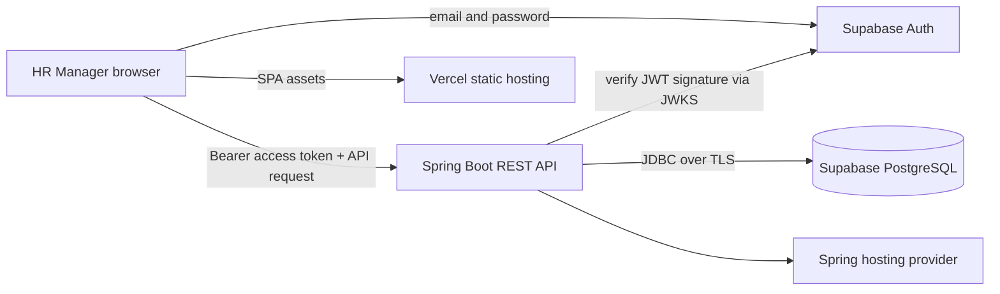

# Architecture and request flow

## Responsibilities

- **Angular** owns presentation, route guards, reactive forms, accessible navigation, client-side input feedback, and token forwarding. It never talks directly to salary tables.
- **Supabase Auth** handles passwords, signup/login, session refresh, and issues access JWTs. Angular uses only the publishable key.
- **Spring Boot** owns validation, access-token enforcement, API contracts, pagination, sorting allowlists, salary-change audit writes, and aggregations.
- **Supabase Postgres** stores current employee and audit records. Migration SQL is versioned in this repository.
- **Vercel** serves the built Angular SPA. A separate free-tier friendly Java host runs Spring Boot; see deployment guide.

## Auth synchronization

1. Angular signs up or signs in through `@supabase/supabase-js` email/password methods.
2. Supabase returns a session and access token.
3. An Angular HTTP interceptor attaches `Authorization: Bearer <access_token>` to `/api/**` requests.
4. Spring Security validates the JWT signature against the project's published JWKS, validates issuer and time claims, and derives the authenticated principal from `sub`.
5. Missing or invalid tokens receive HTTP 401. The API does not accept a user ID supplied by the browser as proof of identity.

JWT signing keys should be configured with asymmetric signing enabled in Supabase. If a project is configured to use legacy HS256 signing, this JWKS verifier will reject those tokens; do not copy the JWT secret into the app to work around it. Configure asymmetric signing or implement a server-only legacy verification option if you consciously choose that trade-off.

## Data model

`employees` stores the current state and uses `version` for optimistic concurrency. Salary is `numeric(14,2)` and always paired with an ISO 4217 currency code. `salary_audit` stores a separate history entry for each salary modification. Employee number is unique. Indexes support directory searches and common grouping dimensions.

## Performance decisions

- Directory requests return at most 100 rows per page and use SQL predicates/order/offset in the database.
- The client never retrieves all 10,000 records for search or filtering.
- Search is case-insensitive with PostgreSQL `ILIKE`; indexes are added for common equality filters. For substantially larger data or fuzzy search, evaluate trigram indexes or full-text search with measured query plans.
- Dashboard aggregation is done by PostgreSQL, grouping by currency. A small demo dataset does not justify a cache/materialized view; add one after observing latency.

## Security boundaries

- CORS is restricted to configured frontend origins.
- Auth tokens are validated by Spring Security before API controllers run.
- Database connectivity uses server-only credentials and TLS.
- Passwords are never handled or stored by the Spring app.
- Salary edits create an audit row in the same database transaction as the employee update.
- This is an assessment prototype: before real use, add HR role/permission enforcement, tenant scope, rate limiting, alerting, backups/restore drills, privacy review, and operational secret rotation.
