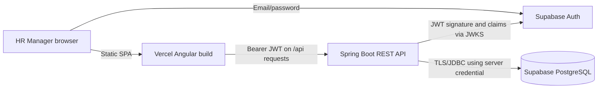
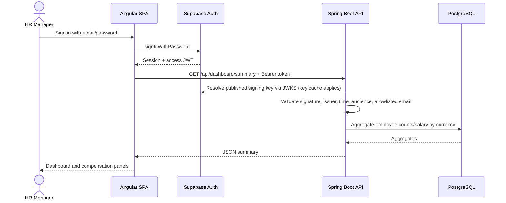
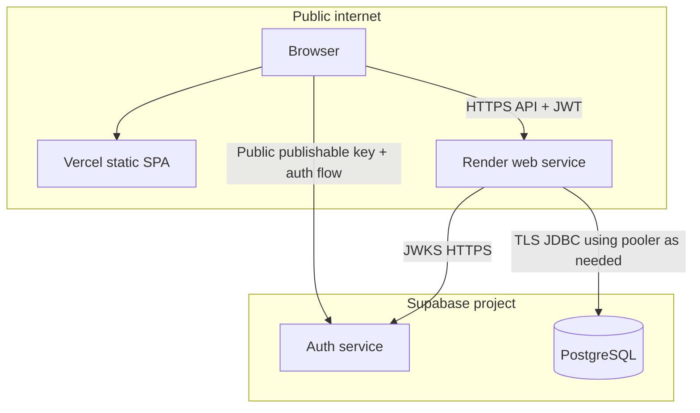

# Architecture

## Context and component boundaries



### Responsibility allocation

- **Angular 20:** screens, form feedback, navigation, route guard, Supabase browser client, bearer-token interceptor, API calls. It is a public client and must contain no database password, service-role key, or private signing secret.
- **Supabase Auth:** password lifecycle, session creation/refresh, signed access tokens. Employee records are not Supabase Auth identities.
- **Spring Boot 3.5 / Java 21:** REST surface, JWT verification, HR email allowlist, DTO validation, query bounds/allowlists, salary update transaction, audit insertion, API error responses, aggregation SQL.
- **Supabase PostgreSQL:** relational source of truth, unique constraints, checks, indexes, update timestamp trigger, employee and audit tables.
- **Vercel:** compiles and serves the Angular SPA. A rewrite sends client-side routes to `index.html`.
- **Render:** runs the Java service in a Docker container; `/actuator/health` is the deployment health-check endpoint.

## Request flow: protected read



## Request flow: salary update

```mermaid
sequenceDiagram
  actor HR as HR Manager
  participant UI as Angular SPA
  participant API as Spring Boot API
  participant DB as PostgreSQL
  HR->>UI: Enter amount, currency, reason
  UI->>API: PUT /api/employees/{id}/salary (expectedVersion)
  API->>API: Validate amount/precision/currency/reason
  API->>DB: Begin transaction; read current employee/version
  API->>API: Compare expectedVersion
  alt Version is stale
    API-->>UI: 409 Conflict; no silent overwrite
  else Version matches
    API->>DB: Update salary/version
    API->>DB: Insert audit old/new amount and currency, actor, timestamp, reason
    DB-->>API: Commit
    API-->>UI: Updated employee
  end
```

## Data and trust boundaries

1. The browser is untrusted. A route guard improves UX but is not authorization.
2. API authorization is enforced by Spring Security. The backend must not trust identity supplied only in a request body.
3. Database credentials are server-only. Supabase browser roles `anon` and `authenticated` have RLS enabled with explicit deny policies on `employees` and `salary_audit`.
4. Audit and employee changes should share a transaction. If one operation fails, do not leave salary changed without history.
5. `SUPABASE_ALLOWED_HR_EMAILS` is a deployment-level allowlist appropriate to a single-persona assessment. It is not a substitute for a role/organization model in production.

## Source layout

- `frontend/src/app/pages/`: login, dashboard, employee directory, employee details, insights.
- `frontend/src/app/core/`: Supabase service, API service, auth guard/interceptor, model types and tests.
- `backend/src/main/java/co/incubyte/salary/`: security/config, dashboard, employee domain, common health/error types.
- `infra/supabase/migrations/`: versioned schema and RLS policies.
- `infra/scripts/`: repeatable synthetic seed SQL.
- `docs/`: requirements, API contract, decisions, deploy and demo guidance.

## Deployment topology



## Deliberate simplicity

This is a modular monolith, not microservices. With one persona, a 10k-row dataset, and a handful of read/write operations, one API deployment and a relational database provide simple consistency boundaries and easy-to-review behavior. Additional services, caches, message queues, and analytics pipelines would add operational work without a demonstrated need.
