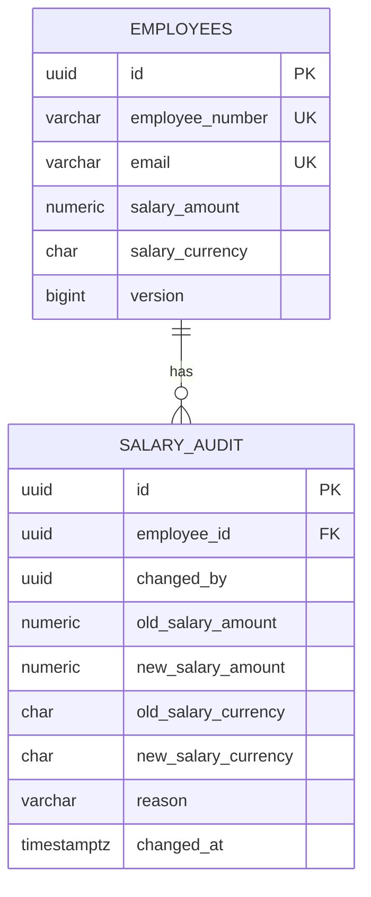

# Data Model, Constraints, and Seed Strategy

## `public.employees`

| Column | Type | Rule / reason |
|---|---|---|
| `id` | UUID | Primary key generated by `gen_random_uuid()` |
| `employee_number` | `varchar(32)` | Required and unique; human-facing stable identifier |
| `first_name`, `last_name` | `varchar(100)` | Required; full name is not unique in production |
| `email` | `varchar(254)` | Required and unique; work contact identifier |
| `country_code` | `char(2)` | Required; ISO-like two-letter country code used for grouping |
| `country_name` | `varchar(100)` | Required display label |
| `department` | `varchar(100)` | Required; grouping/filter dimension |
| `job_title` | `varchar(120)` | Required; searchable role label |
| `employment_status` | `varchar(20)` | Required; constrained to `ACTIVE`, `ON_LEAVE`, `TERMINATED` |
| `hire_date` | `date` | Required; date-only business value |
| `salary_amount` | `numeric(14,2)` | Required, non-negative decimal; never floating-point money in backend |
| `salary_currency` | `char(3)` | Required three-letter currency identifier paired with amount |
| `version` | `bigint` | Non-negative optimistic concurrency version |
| `created_at`, `updated_at` | `timestamptz` | Required timestamps; trigger maintains `updated_at` |

## `public.salary_audit`

| Column | Type | Rule / reason |
|---|---|---|
| `id` | UUID | Audit entry primary key |
| `employee_id` | UUID | FK to employee; `ON DELETE RESTRICT` preserves audit history |
| `changed_by` | UUID | Supabase subject UUID from the validated JWT |
| `changed_at` | `timestamptz` | Database-generated timestamp |
| `old_salary_amount`, `new_salary_amount` | `numeric(14,2)` | Both non-negative |
| `old_salary_currency`, `new_salary_currency` | `char(3)` | Currency is retained on both sides of the change |
| `reason` | `varchar(500)` | Required explanation supplied by HR |

A check constraint rejects audit rows that record no actual change to either amount or currency. An index on `(employee_id, changed_at desc)` supports a record's recent history.

## Relationships and integrity



## Indexes in migration `001_initial_schema.sql`

- `(country_code, department)`: common grouping/filter path.
- `employment_status`: status filters and counts.
- `employee_number`: unique key already also enforces lookup index semantics; the extra index should be reviewed as potentially redundant during query-plan tuning.
- `(last_name, first_name)`: default directory ordering.
- `hire_date`: possible sorting/filtering.
- `salary_audit(employee_id, changed_at DESC)`: latest audit records for an employee.

A production database review should use `EXPLAIN (ANALYZE, BUFFERS)` on representative queries and remove redundant indexes if confirmed. Indexes increase write/storage cost and should match real access patterns.

## Migrations

- `001_initial_schema.sql`: tables, constraints, indexes, update timestamp trigger, enables RLS.
- `002_lock_down_browser_data_access.sql`: explicit deny policies for `anon` and `authenticated` and hardens the trigger's `search_path`.

Both are SQL assets in `infra/supabase/migrations/`. Apply them in order in a clean/staging Supabase database before production changes. Database migration execution should be reviewed and versioned; do not edit a live schema only through the console without recording the change.

## Seed requirements

- Exactly 10,000 employee rows on an empty database.
- Stable employee numbers `ACME-00001` to `ACME-10000` and unique `.test` emails.
- Synthetic, reproducible values; no actual employees or passwords.
- A repeat run is safe and does not create duplicate rows (`ON CONFLICT (employee_number) DO NOTHING`).
- Seed scripts do not create 10,000 Supabase Auth accounts. Auth accounts are only for HR login.
- The seed version in `infra/scripts/seed-employees.sql` uses a small first/last-name pool; those names can repeat. [`implementation-assets/seed-employees-unique-names.sql`](../implementation-assets/seed-employees-unique-names.sql) is a replacement candidate that uses 100 first names × 100 last names and assigns a unique pair to each seed ID. On a populated database, `ON CONFLICT DO NOTHING` preserves existing rows rather than renaming them; use the replacement primarily for a clean deterministic seed and review before replacing the existing script.

## Queryable validation checks

```sql
-- Count and identity uniqueness
select count(*) as rows,
       count(distinct employee_number) as distinct_employee_numbers,
       count(distinct email) as distinct_emails,
       count(distinct id) as distinct_ids
from public.employees;

-- Seed range
select count(*) as seed_rows,
       min(employee_number) as first_id,
       max(employee_number) as last_id
from public.employees
where employee_number ~ '^ACME-[0-9]{5}$';

-- Synthetic full-name uniqueness is useful for the demo, but is not a
-- general business invariant for real employees.
select count(*) as distinct_seeded_full_names
from (select distinct first_name, last_name
      from public.employees
      where employee_number ~ '^ACME-[0-9]{5}$') names;

-- Check grouped data for expected cardinality
select count(distinct country_code) as countries,
       count(distinct department) as departments
from public.employees;
```

## Live data snapshot noted during assessment

A Supabase SQL check after the unique-name update reported 10,001 rows total: 10,000 seeded `ACME-xxxxx` rows and one additional manual/test row with a non-seed employee number. All employee IDs/numbers/emails were unique. The 10,000 seeded rows had 10,000 unique full names. Remove the additional record only if the intended demo data should be exactly 10,000 total rows; do not run a broad delete without reviewing its ID and audit references.
